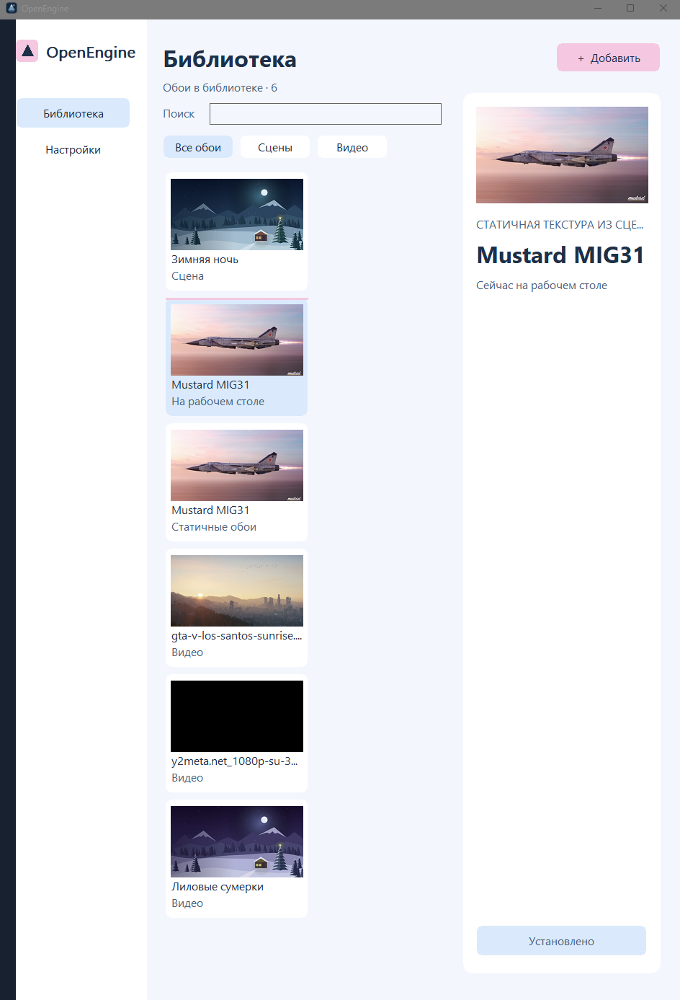

# OpenEngine

[Русский](README.md) · **English** · [简体中文](README.zh-CN.md)

Live wallpapers for Windows 11. Use the built-in Winter Night scene or add your own video. OpenEngine draws behind the desktop icons and keeps the wallpaper running when you close the library window.



## Getting started

1. Download and run [OpenEngine.exe from Releases](../../releases/latest). The built-in scene works out of the box.
2. To use your own video, click **Add**, choose an MP4, M4V, or WMV file, then select its card and click **Set as wallpaper**.
3. Right-click the OpenEngine tray icon to open the library, pause playback, toggle startup, or quit. Quitting brings back the usual Windows background.

To prepare video wallpapers, install [FFmpeg](https://ffmpeg.org/download.html), make it available on PATH, and reopen OpenEngine.

```powershell
winget install --id Gyan.FFmpeg --exact
```

OpenEngine copies each imported video and prepares a frame cache, so the library takes up more space than the original files. FFmpeg runs during preparation. The Rust engine reads the cached frames locally and loops the video without audio. Settings and wallpapers are stored under `%LOCALAPPDATA%\OpenEngine\Library`.

## Importing from Wallpaper Engine

Drop videos, ZIP archives, or Wallpaper Engine project folders onto the library. Use **Add** to pick a `project.json` file. OpenEngine imports the video named in the project. Supported formats are MP4, M4V, WMV, WebM, and MKV.

For supported PKGV0018 `scene.pkg` projects, OpenEngine extracts the largest supported PNG texture as a still wallpaper. Scene shaders, particles, and animation require Wallpaper Engine.

## Appearance

In Settings, choose the white or dark theme and switch between Russian, English, and Simplified Chinese. The library cards and selection pane take inspiration from [Lively Wallpaper](https://github.com/lively-community/lively/wiki/Getting-Started).

## Rust, threads, and memory

OpenEngine is written in Rust and uses Win32/GDI. The engine owns the desktop surface and tray icon. The library opens in a separate process that exits when you close the window.

- The window thread handles Windows messages, controls, and drawing. A background import thread copies the source file and prepares the frame cache, so the library remains responsive.
- During playback, a worker reads JPEG frames from disk. It hands off just the newest decoded frame through a single slot protected by a `Mutex`. If drawing falls behind, the worker replaces the older frame, keeping memory bounded.
- When the active window covers the primary display, the engine stops its drawing timer and the video worker sleeps on a `Condvar`. The winter artwork is embedded in the executable. For imported videos, FFmpeg prepares the cache once and the Rust worker decodes it during playback.

On Windows 11 x64 build 26200 at 2560×1440, a short H.264 MP4 looping with the library open used about **8.9 MiB of combined private working set**. The measurement used `WorkingSetPrivate` for the OpenEngine processes. The full working set is higher because it includes shared pages. The file picker and video preparation temporarily use more memory. Results vary by video and system.

The winter scene is rendered at 3840×2160. Detail mode preserves source resolution up to 3840×2160, with dimensions aligned for decoding, at 15 fps. Select 540p in Settings to reduce memory and disk usage. The measurement above applies to 540p. Wallpapers render on the primary monitor.

## Building

Install [Rust](https://rustup.rs/) and the Visual Studio Build Tools with MSVC and the Windows SDK.

```powershell
cargo build --locked --release
.\target\release\OpenEngine.exe
```

You can also build with [llvm-mingw](https://github.com/mstorsjo/llvm-mingw). Add its `bin` directory to PATH and set the linker.

```powershell
rustup target add x86_64-pc-windows-gnullvm
$env:CARGO_TARGET_X86_64_PC_WINDOWS_GNULLVM_LINKER = "x86_64-w64-mingw32-clang.exe"
cargo build --locked --release --target x86_64-pc-windows-gnullvm
```

## Releases

A tag such as `v0.4.0` triggers a Windows build in GitHub Actions. The workflow attaches `OpenEngine.exe` and the source ZIP to the release.

## License

The code and built-in artwork are released under the [MIT license](LICENSE).
