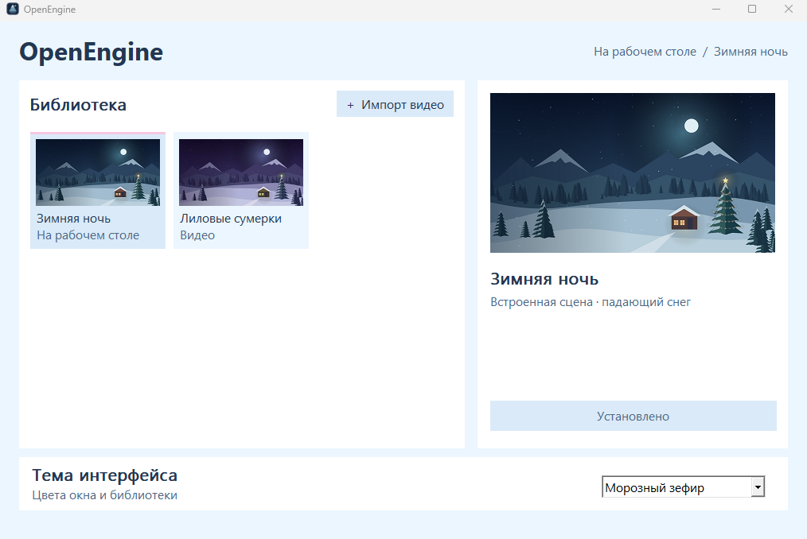

# OpenEngine

**Русский** · [English](README.en.md) · [简体中文](README.zh-CN.md)

Живые обои для Windows 11. Выбери «Зимнюю ночь» или добавь своё видео. OpenEngine показывает обои за значками рабочего стола, а окно библиотеки можно закрыть.



## Запуск

1. Скачай [OpenEngine.exe из Releases](../../releases/latest) и запусти. Для встроенной сцены достаточно одного файла.
2. Чтобы добавить ролик, нажми **Импорт видео** и выбери MP4, M4V или WMV. Выбери карточку и нажми **На рабочий стол**.
3. Правый клик по значку OpenEngine в трее открывает библиотеку, паузу, автозапуск и выход. После выхода Windows показывает обычный фон.

Для подготовки видео нужен [FFmpeg](https://ffmpeg.org/download.html) в PATH. В Windows его можно установить через WinGet и затем открыть OpenEngine заново.

```powershell
winget install --id Gyan.FFmpeg --exact
```

OpenEngine копирует видео и создаёт кэш кадров для воспроизведения. По этой причине библиотека занимает больше места, чем исходные ролики. FFmpeg нужен на этапе подготовки. После неё Rust читает кадры локально, видео повторяется без звука. OpenEngine сохраняет настройки и библиотеку в `%LOCALAPPDATA%\OpenEngine\Library`.

## Оформление

**Морозный зефир** сочетает голубой, белый и розовый. **Персиковый плед** добавляет тёплый коралловый оттенок, а **Мятный чай** использует светлые зелёные тона. Тема меняет окно библиотеки. Карточки, миниатюры и панель выбранных обоев устроены по мотивам [библиотеки Lively Wallpaper](https://github.com/lively-community/lively/wiki/Getting-Started).

## Память и воспроизведение

OpenEngine написан на Rust и использует Win32/GDI. Движок управляет фоном и значком в трее. Библиотека запускается отдельным процессом по запросу и завершается при закрытии окна.

- Поток окна обрабатывает сообщения Windows, кнопки и отрисовку. Импорт работает в фоновом потоке, поэтому копирование файла и подготовка кэша не блокируют интерфейс.
- Во время воспроизведения рабочий поток читает JPEG-кадры с диска и передаёт потоку отрисовки один последний готовый кадр через слот под `Mutex`. Если отрисовка отстала, устаревший кадр заменяется, поэтому очередь не растёт.
- Когда активное окно перекрывает основной монитор, движок выключает таймер отрисовки, а видеопоток ожидает на `Condvar`. Встроенный фон хранится в EXE. Для видео FFmpeg один раз подготавливает кэш, после чего рабочий поток декодирует кадры средствами Rust.

Проверено на Windows 11 x64, сборка 26200, экран 2560×1440. После импорта короткого H.264 MP4 зацикленное воспроизведение вместе с открытой библиотекой заняло суммарно около **8,9 МиБ частного рабочего набора**. Замер сделан по счётчику `WorkingSetPrivate` для процессов OpenEngine. Полный рабочий набор, включая разделяемые страницы, больше. Диалог выбора файла и подготовка видео временно требуют дополнительной памяти. Результат для других роликов и систем может отличаться.

Зимний фон встроен в разрешении 1600×900. Видео подготавливается в 960×540 при 15 к/с, а изображение масштабируется со сглаживанием. Текущая версия выводит обои на основной монитор.

## Сборка

Для обычной сборки нужны [Rust](https://rustup.rs/) и MSVC с Windows SDK из Visual Studio Build Tools.

```powershell
cargo build --locked --release
.\target\release\OpenEngine.exe
```

Сборка через [llvm-mingw](https://github.com/mstorsjo/llvm-mingw) также поддерживается. Добавь папку `bin` LLVM в PATH, затем укажи его компоновщик.

```powershell
rustup target add x86_64-pc-windows-gnullvm
$env:CARGO_TARGET_X86_64_PC_WINDOWS_GNULLVM_LINKER = "x86_64-w64-mingw32-clang.exe"
cargo build --locked --release --target x86_64-pc-windows-gnullvm
```

## Лицензия

Код и встроенная сцена распространяются по [лицензии MIT](LICENSE).
