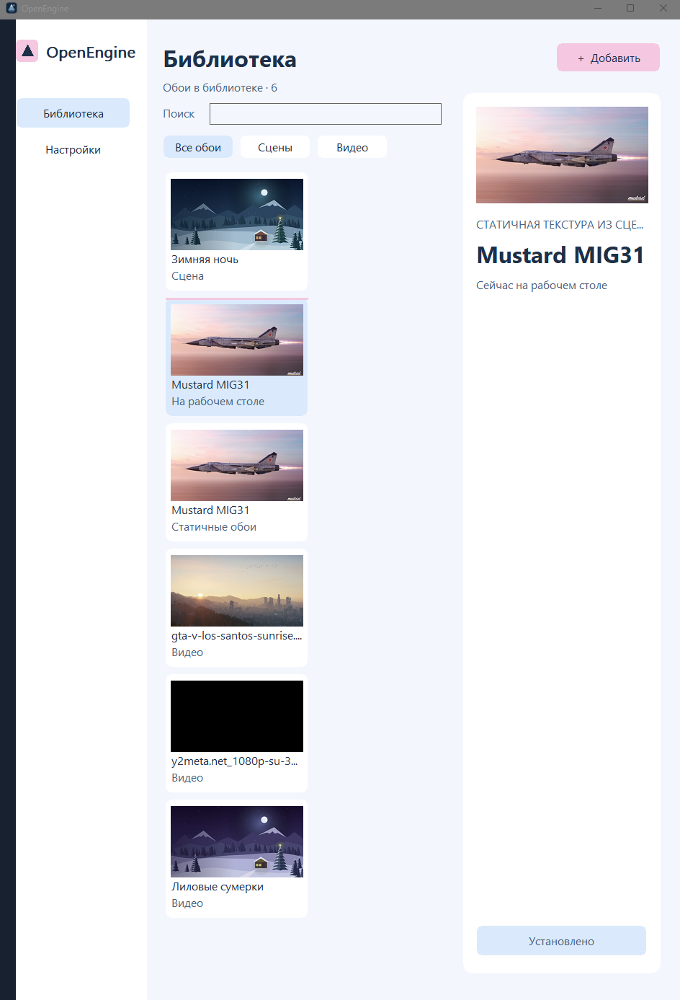

# OpenEngine

[Русский](README.md) · [English](README.en.md) · **简体中文**

适用于 Windows 11 的动态壁纸工具。你可以选用内置的「冬夜」场景，也可以导入自己的视频。壁纸显示在桌面图标后方，关闭壁纸库窗口后仍会继续播放。



## 快速开始

1. 从 [Releases 下载 OpenEngine.exe](../../releases/latest) 并运行。内置场景开箱即用。
2. 要使用自己的视频，点击 **添加**，选择 MP4、M4V 或 WMV 文件，再选中对应卡片并点击 **设为桌面壁纸**。
3. 右键点击通知区域中的 OpenEngine 图标，可打开壁纸库、暂停播放、设置开机启动或退出。退出后，Windows 会重新显示原来的桌面背景。

导入视频前，请安装 [FFmpeg](https://ffmpeg.org/download.html)，确认它已加入 PATH，然后重新打开 OpenEngine。

```powershell
winget install --id Gyan.FFmpeg --exact
```

OpenEngine 会复制导入的视频并生成帧缓存，因此壁纸库的磁盘占用会大于原始视频。FFmpeg 只在准备缓存时运行。播放时由 Rust 引擎读取本地缓存，视频静音循环。设置和壁纸保存在 `%LOCALAPPDATA%\OpenEngine\Library`。

## 从 Wallpaper Engine 导入

把视频、ZIP 压缩包或 Wallpaper Engine 项目文件夹拖入壁纸库，也可以点击「添加」选择 `project.json`。OpenEngine 会导入项目指定的视频。支持 MP4、M4V、WMV、WebM 和 MKV。

对于支持的 PKGV0018 格式 `scene.pkg` 项目，OpenEngine 可提取支持范围内最大的 PNG 纹理，设为静态壁纸。场景着色器、粒子和动画需要 Wallpaper Engine。

## 界面与语言

在设置中可以选择白色或深色主题，并切换俄语、英语及简体中文。卡片和壁纸预览面板参考了 [Lively Wallpaper](https://github.com/lively-community/lively/wiki/Getting-Started)。

## Rust、多线程和内存优化

OpenEngine 使用 Rust 开发，通过 Win32/GDI 绘制。引擎负责桌面壁纸和通知区域图标。壁纸库按需启动独立进程，关闭窗口后该进程退出。

- 窗口线程处理 Windows 消息、控件和绘制。后台导入线程负责复制视频和生成帧缓存，导入期间仍可操作界面。
- 播放时，工作线程从磁盘读取并解码 JPEG 帧，再通过由 `Mutex` 保护的单槽缓冲区交给绘制线程。如果绘制速度较慢，新帧会替换旧帧，缓冲区不会越积越大。
- 当前窗口覆盖主显示器时，引擎停止绘制定时器，视频线程在 `Condvar` 上等待。冬夜背景内置于可执行文件中。导入的视频由 FFmpeg 一次性生成缓存，播放阶段由 Rust 工作线程解码。

在 Windows 11 x64（内部版本 26200）、2560×1440 分辨率下测试，导入一段短 H.264 MP4 后，在打开壁纸库并循环播放的情况下，OpenEngine 进程的**私有工作集总计约为 8.9 MiB**，取自 `WorkingSetPrivate` 计数器。包含共享内存页的完整工作集会更高。文件选择对话框和视频预处理会暂时增加内存占用，实际结果取决于视频和系统。

内置冬夜场景以 3840×2160 渲染。高清模式保留最高 3840×2160 的源视频分辨率（尺寸按解码要求对齐），以每秒 15 帧播放。可在设置中切换到 540p 以节省内存和磁盘空间。上文的内存测试适用于 540p。壁纸显示在主显示器上。

## 从源码构建

安装 [Rust](https://rustup.rs/)，以及带有 MSVC 和 Windows SDK 的 Visual Studio Build Tools。

```powershell
cargo build --locked --release
.\target\release\OpenEngine.exe
```

也可以使用 [llvm-mingw](https://github.com/mstorsjo/llvm-mingw)。将其 `bin` 目录加入 PATH，再指定链接器。

```powershell
rustup target add x86_64-pc-windows-gnullvm
$env:CARGO_TARGET_X86_64_PC_WINDOWS_GNULLVM_LINKER = "x86_64-w64-mingw32-clang.exe"
cargo build --locked --release --target x86_64-pc-windows-gnullvm
```

## 发布

推送形如 `v0.4.0` 的标签会触发 GitHub Actions 的 Windows 构建，并自动将 `OpenEngine.exe` 和源代码压缩包附加到发布页面。

## 许可证

源代码和内置场景采用 [MIT 许可证](LICENSE)。
